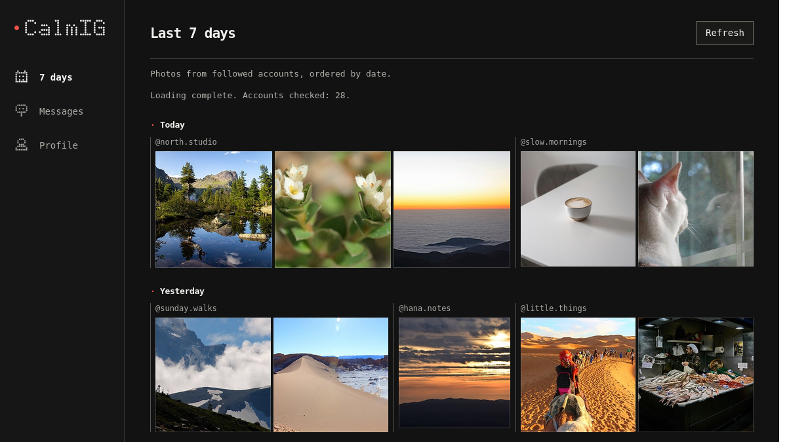

# CalmIG

**A quieter way to keep up with photos and conversations.**

CalmIG is an experimental desktop client for personal Instagram accounts. Instead of an endless feed, it gives you a seven-day photo calendar grouped by day and author. Open a photo when you want to, catch up on messages, and leave when you are done.

The interface is available in **English and Russian**. The current version is **0.1.0-beta.1**.

[Русская версия](#русский) · [Installation](#installation) · [How the calendar works](#how-the-calendar-works) · [Development](#development)



*Interface preview with demonstration data; details may differ from the current build. See the [messages view](docs/screenshots/messages-en.png), [narrow layout](docs/screenshots/mobile-en.png), and [photo credits](docs/screenshots/CREDITS.md).*

## What is in CalmIG

- **A seven-day calendar:** photos from followed accounts, organized by local date and author, with the newest first.
- **Photo posts and carousels:** view still images together instead of filling the calendar with individual slides. Posts containing video are excluded.
- **Conversations around a photo:** read its caption and comments, write a comment, and open the author's profile in the app.
- **Direct messages:** read conversations and send text or links. Unsupported attachments appear as placeholders.
- **A quieter interface:** no Reels, stories, video player, music player, or recommendations feed.
- **Local cache:** previously loaded post details remain available when synchronization fails; images themselves are loaded from Instagram.

## Current status

CalmIG is a **beta Linux desktop development build**, not a finished release. There is no packaged installer or Android APK yet. A responsive layout is included; the mobile screenshot is a layout preview, not an Android app.

The application uses **unofficial Instagram interfaces**. It is not affiliated with or endorsed by Instagram or Meta. Endpoints may change, requests may be rejected, and functions can stop working without an app update. An official Meta API for personal-account Following photos is not used.

### How the calendar works

With browser sign-in on Linux, CalmIG opens Instagram's **Following** view in a hidden WebKit window and gathers photo posts from it. It checks the author relationship when the data is available, excludes videos, mixed photo/video carousels, advertising and ambiguous items, and sorts the accepted posts by publication time within the calendar. Authors whose subscription status cannot be confirmed are omitted.

Synchronization stops on an error and loads **at most 20 pages**. Instagram's response may omit posts or change format, so CalmIG marks the selection as potentially incomplete even when loading finishes. Cached posts are retained alongside new results; they are not a guarantee of a complete or current subscription list. The cache holds up to 250 recent post records, including captions and image URLs, rather than offline image files.

A compatible session from an older version can be restored by username. That legacy path checks followed profiles individually and may be slower or receive a `feedback_required` response. The browser sign-in path uses the Following view described above.

## Installation

### Requirements

- Linux with a graphical desktop, Rust and Cargo.
- The [Tauri v2 Linux prerequisites](https://v2.tauri.app/start/prerequisites/#linux), including WebKitGTK 4.1 development headers.
- Internet access for Instagram and the first Cargo dependency download.

For Ubuntu/Debian, the dependencies used by the project's CI can be installed with:

```sh
sudo apt-get update
sudo apt-get install -y build-essential libwebkit2gtk-4.1-dev libssl-dev \
  libayatana-appindicator3-dev librsvg2-dev patchelf
```

Install Rust via [rustup](https://rustup.rs/) if it is not already installed. Node.js is **not required to build or run CalmIG**; Node.js 22 and npm are only needed for the optional interface tests.

### Build and run

```sh
git clone https://github.com/difp/calmig.git
cd calmig
./quiet-desktop/build.sh
./quiet-desktop/start.sh
```

The build script creates the local development executable `quiet-desktop/tikho`. It is not a standalone distribution package. If the Cargo dependencies are already cached, use `CALMIG_CARGO_OFFLINE=1 ./quiet-desktop/build.sh` to build offline.

### Add CalmIG to the applications menu

After building, install the executable, icon and launcher for the current user:

```sh
./quiet-desktop/install.sh
```

Open **CalmIG** from your applications menu. The launcher runs an installed copy: after rebuilding, run the install script again to update it. By default, the installed files are:

| File | Default location |
| --- | --- |
| Executable | `~/.local/bin/calmig` |
| Application launcher | `~/.local/share/applications/calmig.desktop` |
| Icon | `~/.local/share/icons/hicolor/64x64/apps/calmig.png` |

`XDG_BIN_HOME` and `XDG_DATA_HOME` can change these locations. Removing these files removes the launcher and executable, but does not delete the app's session or cache.

## Sign-in and local data

1. Open CalmIG and select **Open Instagram**.
2. Sign in on the Instagram page in the separate window, including any verification Instagram requests.
3. Return to CalmIG and select **I have signed in**. You can choose the interface language before or after signing in.

CalmIG stores browser session data and its cache locally. It uses that session to access Instagram through unofficial endpoints; the password is entered on Instagram's page, not in a CalmIG password form. Use **Sign out and remove session** in the profile view to remove the app's session and calendar cache, or **Clear cache** to remove cached calendar records.

Treat sessions, cookies, cached post metadata and messages as private. Do not publish them or attach them to bug reports. Compatible older session files may be stored locally without system-keyring encryption.

## Development

The application uses Rust and Tauri for the desktop backend, WebKit for the embedded browser, and HTML, CSS and JavaScript for the interface. The optional Node.js tooling is limited to interface tests.

```sh
# Rust core and desktop tests
cargo test --manifest-path rust-core/Cargo.toml
cargo test --manifest-path quiet-desktop/src-tauri/Cargo.toml

# Formatting
cargo fmt --manifest-path rust-core/Cargo.toml -- --check
cargo fmt --manifest-path quiet-desktop/src-tauri/Cargo.toml -- --check

# Interface tests (Node.js 22+)
npm ci
npm test
```

Tests use synthetic data and local fake servers. They do not establish that Instagram's live interfaces will continue to work, and they do not publish real comments or messages. See the [desktop notes](quiet-desktop/README.md) and [Following research](docs/instagram-following-research.md) for implementation details and limitations.

## Русский

**Спокойный способ следить за фотографиями и переписками.**

CalmIG — экспериментальный настольный клиент Instagram для личного аккаунта. Вместо бесконечной ленты он показывает фотографии подписок за семь дней, группируя их по датам и авторам. Интерфейс доступен на русском и английском языках. Текущая версия — **0.1.0-beta.1**.

В приложении можно просматривать фотографии и карусели, читать подписи и комментарии, оставлять комментарии, открывать профили и переписываться. Вложения в переписках, которые приложение не поддерживает, отображаются как заглушки. Reels, истории, видеоплеер, музыка и лента рекомендаций не входят в интерфейс; публикации с видео и смешанные карусели исключаются.

### Состояние проекта

Сейчас доступна **бета-сборка для Linux**. Готового установочного пакета и Android APK пока нет; мобильный скриншот показывает адаптивную компоновку интерфейса.

CalmIG использует **неофициальные интерфейсы Instagram** и не связан с Instagram или Meta. Доступ может измениться или быть ограничен. При браузерном входе на Linux приложение получает публикации из режима Following во встроенном окне WebKit, проверяет доступные признаки подписки и сортирует подходящие фотографии по дате. Авторы без подтверждённой подписки исключаются.

За одну синхронизацию загружается не более **20 страниц**; при ошибке она останавливается без автоматического повтора. Instagram может вернуть не все публикации, поэтому приложение всегда предупреждает о возможной неполноте, а ранее сохранённые записи остаются доступны. Кеш содержит до 250 записей с подписями и ссылками на изображения, но не сами изображения.

Совместимую сессию старой версии можно восстановить по имени пользователя. При таком восстановлении приложение проверяет подписки по профилям; это может быть медленнее или вызвать отказ `feedback_required`.

### Установка и запуск

Установите Rust и [системные зависимости Tauri v2](https://v2.tauri.app/start/prerequisites/#linux), затем выполните:

```sh
git clone https://github.com/difp/calmig.git
cd calmig
./quiet-desktop/build.sh
./quiet-desktop/start.sh
```

Команда установки зависимостей для Ubuntu/Debian приведена в разделе [Requirements](#requirements). Node.js 22 и npm нужны только для необязательных тестов интерфейса, для сборки и запуска приложения они не требуются.

Чтобы добавить приложение в меню GNOME и других совместимых рабочих столов, после сборки выполните:

```sh
./quiet-desktop/install.sh
```

Найдите **CalmIG** в списке приложений. После пересборки повторите команду установки, чтобы обновить запускаемую копию. Пути к исполняемому файлу, ярлыку и значку указаны в [таблице установки](#add-calmig-to-the-applications-menu); их удаление не удаляет сессию и кеш.

### Вход и данные

Нажмите **«Открыть Instagram»**, войдите в открывшемся окне и подтвердите вход, если Instagram попросит. Затем вернитесь в CalmIG и нажмите **«Я вошёл»**. Пароль вводится на странице Instagram; собственной формы пароля в CalmIG нет.

Сессия и кеш хранятся локально. В профиле доступны **«Выйти и удалить сессию»** и **«Очистить кеш»**. Не публикуйте файлы сессии, cookie, кеш с личными публикациями и переписки. Совместимые файлы старых сессий могут храниться без шифрования системным хранилищем ключей.

Команды тестирования и форматирования приведены в разделе [Development](#development). Тесты используют фиктивные данные и не подтверждают работу живых интерфейсов Instagram.

## Credits and license

CalmIG is based on [instagram-cli](https://github.com/supreme-gg-gg/instagram-cli), originally by Jet Chiang and James Zheng. The original [MIT license](LICENSE) is retained. The compatible device generator derives from Chance.js; its license is included in [CHANCE-LICENSE](rust-core/CHANCE-LICENSE). See [photo credits](docs/screenshots/CREDITS.md) for the images used in screenshots.
